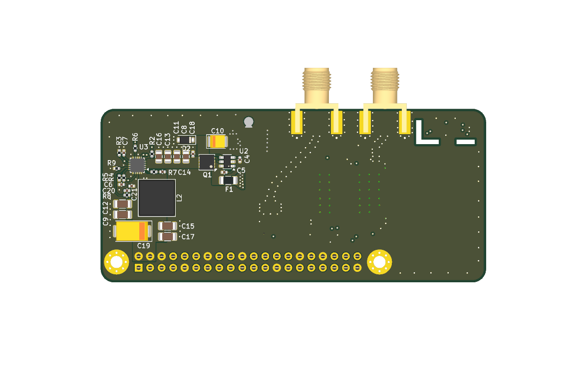

# x1500_gps_12v

KiCad project for a daughterboard that powers a [Geekworm X1500](https://geekworm.com/products/x1500) (Raspberry Pi CM5,
1GbE, Dual M.2 NVMe SSD). It powers the Pi from 12V and adds a NEO-M9N GPS receiver 
with PPS, an SHT45 humidity sensor and a BMP581 pressure sensor. Also has a u.fl to SMA
jumper to help with attaching a WiFi Antenna.

Note this PCB does not cover the CM5 and its heat sink. If using another Pi board 
remember that it does not stack like a regular pi-hat.



## Driver software

The [Go GPS/weather library and diagnostic tools](driver/README.md) are in
`driver/`. They run on the Raspberry Pi and are licensed under AGPL-3.0-only.

## Raspberry Pi setup

```sh
sudo apt install gpsd gpsd-clients chrony pps-tools i2c-tools
```

Add to `/boot/firmware/config.txt`:

```
[all]
dtparam=i2c_arm=on
dtparam=uart0=on
dtoverlay=pps-gpio,gpiopin=18
usb_max_current_enable=1
dtparam=pciex1
```

Add to `/etc/default/gpsd`:

```
DEVICES="/dev/ttyAMA0"
GPSD_OPTIONS="-n -s 38400"
USBAUTO="false"
```

Add to `/etc/chrony/conf.d/gps.conf`:

```
refclock SHM 0 refid NMEA offset 0.0 precision 1e-1 noselect
refclock PPS /dev/pps0 refid PPS lock NMEA precision 1e-7 prefer
allow 192.168.0.0/24
```

Add to `/etc/systemd/system/gpsd.socket.d/90-network.conf`:

```
[Socket]
ListenStream=
ListenStream=/run/gpsd.sock
ListenStream=0.0.0.0:2947
```

Enable I2C `/etc/modules-load.d/i2c.conf`:

```
i2c-dev
```

```sh
sudo systemctl daemon-reload
sudo systemctl enable gpsd.socket
sudo reboot
```

`chronyc sources -v` shows PPS selected once the receiver has a fix.

## License

Hardware: [CERN-OHL-S-2.0](LICENSE).

Driver software: [AGPL-3.0-only](driver/LICENSE).
